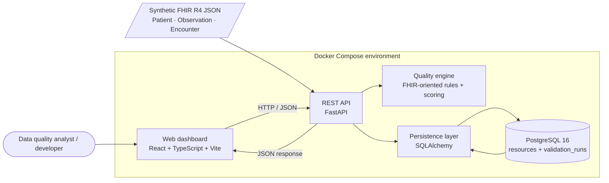
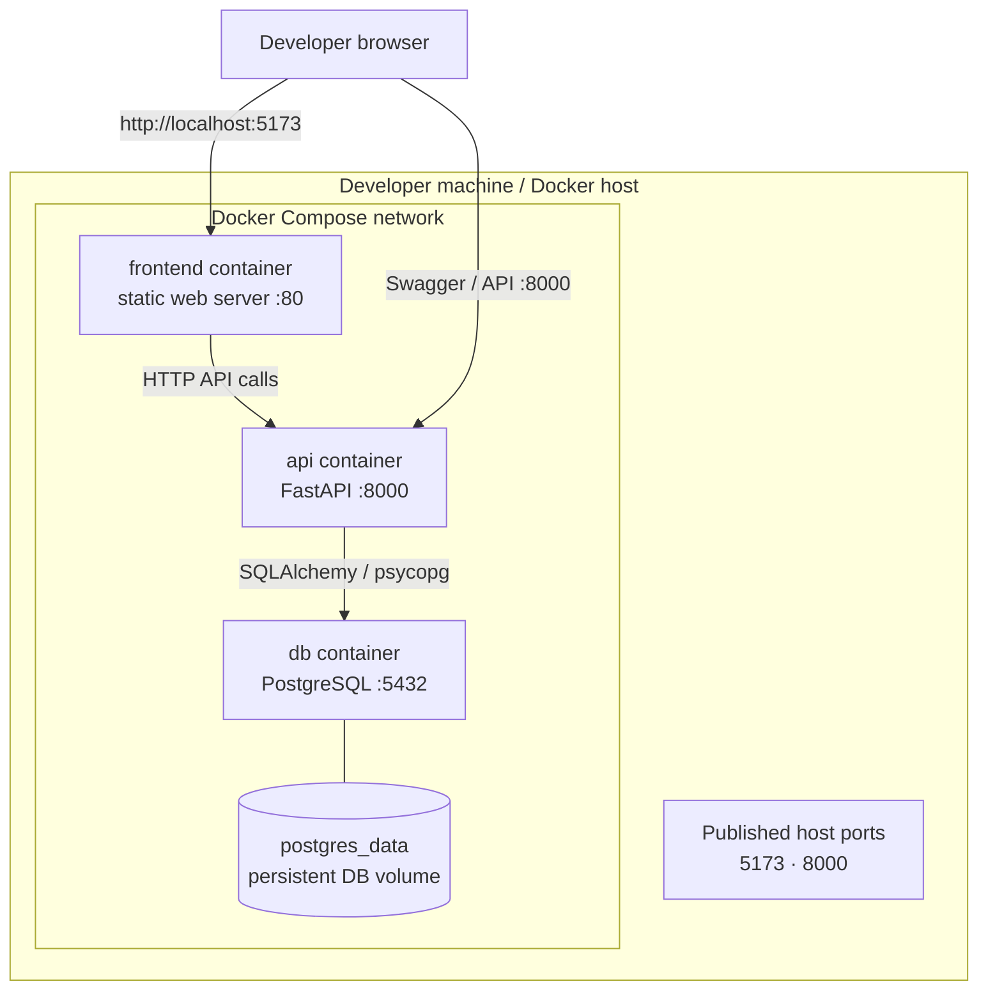
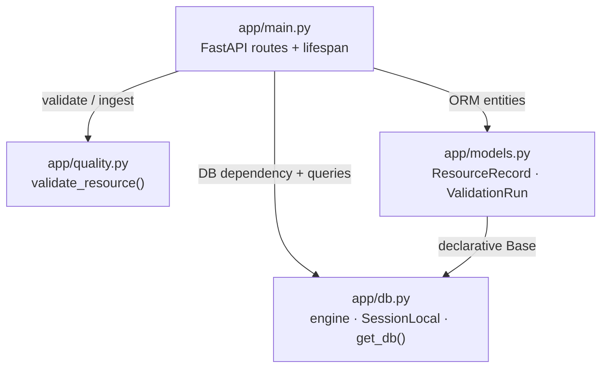
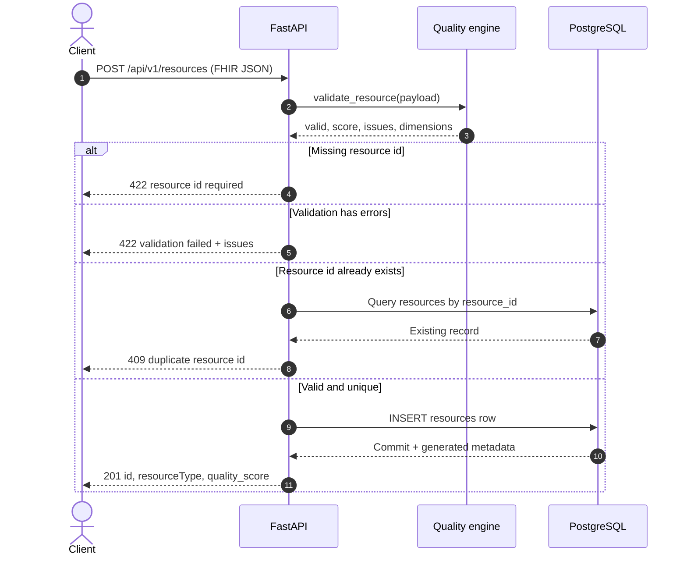
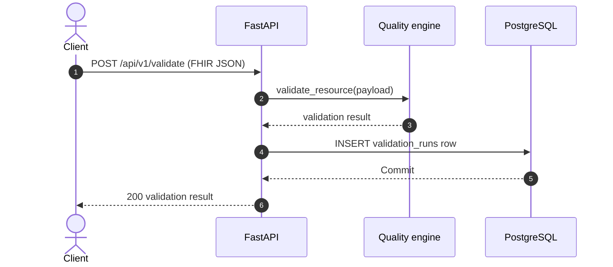
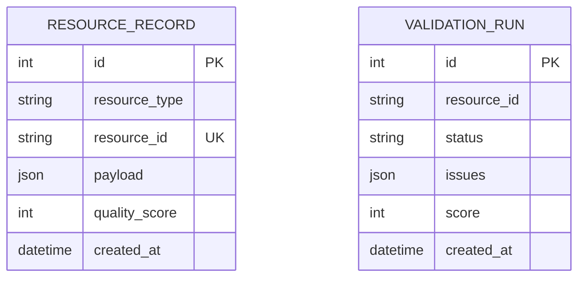
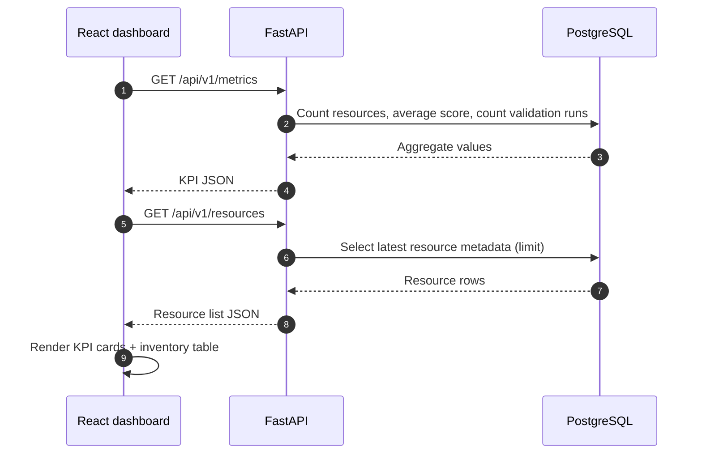

# Architecture — Healthcare FHIR Data Quality & Validation Platform

**Document status:** Current implementation (starter/demo) with explicitly marked production extensions  
**FHIR baseline:** HL7 FHIR R4  
**Primary goal:** Ingest synthetic FHIR resources, run lightweight data-quality checks, persist accepted resources and validation history, and expose operational metrics to a web dashboard.

> **Scope and safety:** This repository is a demonstration platform. Its rules are FHIR-R4-oriented starter checks, not a complete HL7 FHIR R4 StructureDefinition/profile validator. Use only fictional synthetic records. Do not load identifiable patient data or use this system for clinical decisions.

## 1. Architecture at a glance

The solution uses a three-tier architecture:

1. **Presentation:** React, TypeScript and Vite dashboard.
2. **Application:** FastAPI REST service, request validation, quality scoring and API orchestration.
3. **Persistence:** PostgreSQL 16 in Docker Compose, accessed through SQLAlchemy ORM.

The frontend calls the API over HTTP. The API applies quality checks and reads/writes resource and validation-run records in the relational database.

## 2. High-Level Design (HLD)

### 2.1 System context and component architecture

The diagram shows the runtime components and their main dependencies.



### 2.2 Logical layers and responsibilities

| Layer / component | Responsibility | Current technology |
|---|---|---|
| User interface | KPI cards, API connection status, resource inventory | React, TypeScript, Vite |
| API boundary | HTTP routes, request handling, response codes, CORS | FastAPI |
| Quality engine | Supported resource types, required/recommended field checks, selected code checks, subject-reference shape, score | `backend/app/quality.py` |
| Data access | DB engine, sessions, ORM mappings | SQLAlchemy |
| Persistence | Stored resource payloads and validation history | PostgreSQL 16 in Compose; SQLite is local default |
| Packaging | Reproducible local services | Docker, Docker Compose |
| CI | Backend tests and frontend build | GitHub Actions |

### 2.3 Deployment architecture



Docker Compose publishes dashboard port **5173** and API port **8000** to the host. PostgreSQL is reachable by the API on the Compose network; its port is not published by the current Compose file. The named volume preserves database data across container recreation. Removing it with `docker compose down -v` deletes local demo data.

### 2.4 External interfaces

| Interface | Method and path | Purpose |
|---|---|---|
| Health | `GET /health` | Returns API health and declared FHIR version |
| Validate | `POST /api/v1/validate` | Runs checks, records a validation-run row, returns result |
| Ingest | `POST /api/v1/resources` | Validates and persists an accepted resource |
| Resource list | `GET /api/v1/resources` | Returns recent resource metadata |
| Metrics | `GET /api/v1/metrics` | Returns resource count, average score and validation counts |
| API explorer | `GET /docs` | Interactive Swagger UI generated by FastAPI |

Request and response bodies use JSON. The current API accepts Patient, Observation and Encounter resource types only.

## 3. Low-Level Design (LLD)

### 3.1 Backend module design



- **`main.py`:** creates the FastAPI application, configures CORS, creates database tables at startup, and implements the HTTP endpoints.
- **`quality.py`:** evaluates the incoming Python dictionary and returns `valid`, `score`, `issues`, and `dimensions`.
- **`db.py`:** creates the SQLAlchemy engine and session factory. `DATABASE_URL` selects the database; SQLite is the default outside Compose.
- **`models.py`:** defines the `resources` and `validation_runs` tables.

### 3.2 Resource ingestion sequence



The ingestion route validates before persistence. A resource must have an `id`, pass the current rule checks, and have a unique `resource_id`. Invalid resources are rejected with HTTP 422; duplicate IDs return HTTP 409. The current ingestion route does not create a `ValidationRun` row for each accepted resource.

### 3.3 Standalone validation sequence



The standalone validation endpoint records the validation result even when the resource is invalid. If the request has no resource ID, the current implementation records `unidentified`.

### 3.4 Quality checks and scoring

The current rules are deliberately small and transparent:

| Resource | Required/recommended fields checked | Selected value check |
|---|---|---|
| Patient | `name`, `gender` | `gender` in male, female, other, unknown |
| Observation | `status`, `code`, `subject` | Selected R4 Observation status codes |
| Encounter | `status`, `class`, `subject` | Selected R4 Encounter status codes |

The engine also checks that a supplied `subject` is an object containing a string `reference`. Missing fields are currently emitted as **warnings** (despite the helper's `missing-required-data` issue code); error-severity checks determine the `valid` boolean.

Current weighted score:

```
quality_score = round(
    completeness × 0.30
  + validity     × 0.50
  + consistency  × 0.20
) - warning_penalty
```

- Completeness: proportion of listed fields that are present.
- Validity: starts at 100 and is reduced for each error (25 points per error, minimum 0).
- Consistency: 100 unless the subject-reference shape check fails, in which case 50.
- Warning penalty: 2 points per warning; final score is bounded below by 0.
- Uniqueness is reported as a dimension with a placeholder value of 100. Actual duplicate enforcement occurs during persistence through a database lookup and unique column, not as a measured scoring dimension.

These are demo scoring heuristics, not a clinical quality standard or a complete FHIR conformance result.

### 3.5 Data model / logical ER diagram



**Table notes:**

- `resources`: one row per persisted FHIR resource. `resource_id` is unique; `payload` stores the full JSON object; `resource_type` is indexed.
- `validation_runs`: one row per call to the standalone validation endpoint. `issues` stores the returned issue list as JSON. `resource_id` is indexed but is not a foreign key to `resources`; a validation can be performed without ingestion.
- Both tables include creation timestamps. SQLAlchemy `create_all` creates tables at application startup in this starter implementation; Alembic migrations are not yet configured.

### 3.6 Dashboard read flow



The dashboard currently fetches metrics and resource inventory when the React component mounts. It does not yet poll, stream updates, or automatically refresh after ingestion; refresh the browser to retrieve newly ingested data.

## 4. Key design decisions

| Decision | Rationale / current trade-off |
|---|---|
| Three-tier separation | Keeps browser presentation, API logic and persistence responsibilities distinct |
| REST + JSON | Simple integration with FHIR JSON resources and easy API exploration |
| SQLAlchemy ORM | Centralizes database access and supports PostgreSQL and local SQLite |
| JSON payload column | Preserves the submitted resource structure without a separate column for every FHIR element |
| Separate validation history | Allows validation-only requests to be recorded without storing the resource |
| Docker Compose | Provides a repeatable local multi-service environment |
| Synthetic fixtures | Enables repeatable demos and tests without exposing patient information |

## 5. Non-functional considerations and current limitations

### Implemented in this starter
- Health endpoint and interactive OpenAPI documentation.
- Basic supported-type, selected-field, selected-code and subject-reference checks.
- Duplicate resource ID rejection during ingestion.
- Persistent resource payloads and standalone validation-run records.
- Dockerized frontend, API and PostgreSQL services.
- CI workflow for backend tests and frontend production build.

### Not yet implemented — production hardening backlog
1. **FHIR conformance:** validate against official R4 StructureDefinitions, profiles, extensions, cardinalities, invariants and terminology bindings using a maintained validator.
2. **Terminology:** integrate terminology services for ValueSet expansion and CodeSystem validation.
3. **Reference integrity:** resolve references across resources and validate target types and existence.
4. **Security:** add authentication, role-based authorization, secrets management, TLS, restrictive CORS and security testing.
5. **Privacy and audit:** define PHI controls, audit trails, retention/deletion policies and access monitoring before any regulated-data use.
6. **Reliability:** add Alembic migrations, structured logs, tracing, metrics, backups, restore tests and operational alerting.
7. **Scale:** add pagination, asynchronous/batch ingestion, background validation, queueing, idempotency strategy and database indexing based on workload.
8. **Dashboard:** add filters, detail views, validation issue drill-down, time-series trends, export and periodic refresh.
9. **Validation model:** define versioned, configurable rule sets and a documented scoring policy; calculate uniqueness and cross-resource consistency from persisted data rather than placeholders.

## 6. Repository map

```text
.
├── backend/
│   ├── app/
│   │   ├── main.py          # REST API and route orchestration
│   │   ├── quality.py       # Starter FHIR-oriented rules and scoring
│   │   ├── db.py            # SQLAlchemy engine and DB sessions
│   │   └── models.py        # Resource and validation ORM models
│   ├── sample-data/         # Synthetic Patient / Observation / Encounter
│   └── tests/               # Backend tests
├── frontend/
│   └── src/                 # React dashboard
├── docs/
│   ├── architecture.md      # This HLD / LLD document
│   └── setup.md             # Local and Docker setup
├── .github/workflows/       # CI workflow
├── Dockerfile
└── docker-compose.yml
```

## 7. Related documentation

- [Setup and runbook](setup.md)
- [Project README](../README.md)
