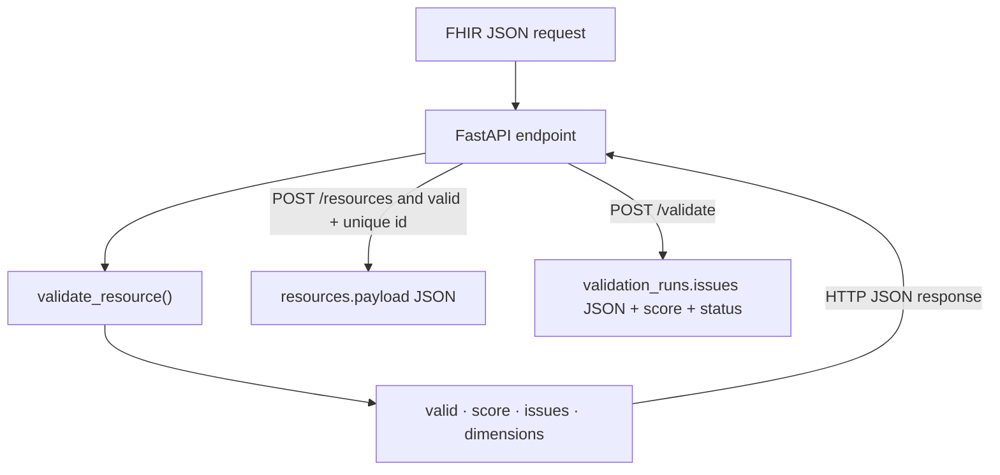

# FHIR Data Dictionary — Healthcare FHIR Data Quality & Validation Platform

**Status:** Describes the current starter implementation  
**FHIR baseline:** HL7 FHIR R4  
**Supported resource types:** `Patient`, `Observation`, `Encounter`

> **Important:** This is an implementation data dictionary, not a replacement for the official FHIR R4 specification or a profile definition. The platform accepts JSON objects and applies a small set of starter checks. It does not currently perform full StructureDefinition, cardinality, terminology, invariant, or profile validation. Use fictional synthetic data only; do not submit identifiable patient information or use results for clinical decisions.

## 1. Ingestion contract

The ingestion endpoint is `POST /api/v1/resources` with a FHIR JSON resource as the request body.

| Property | Current behavior |
|---|---|
| Payload format | JSON object representing one resource |
| Supported `resourceType` | `Patient`, `Observation`, `Encounter` |
| Resource identifier | Top-level `id` is required by the ingestion endpoint |
| Validation | Runs before persistence |
| Invalid resource | HTTP 422 with validation details |
| Duplicate identifier | HTTP 409 when the top-level `id` already exists |
| Successful ingestion | HTTP 201 with `id`, `resourceType`, and `quality_score` |
| Payload storage | Full submitted JSON is stored in the `resources.payload` JSON column |

The standalone `POST /api/v1/validate` endpoint accepts a JSON object and returns a validation result. It records a row in `validation_runs`, including for invalid resources. It does not persist the resource payload. When the resource has no `id`, the validation-run record uses `unidentified`.

## 1.1 Machine-readable JSON Schemas

Starter JSON Schema documents are maintained under `schemas/fhir-r4/` using JSON Schema Draft 2020-12:

| Resource | Schema |
|---|---|
| Patient | [`Patient.schema.json`](../schemas/fhir-r4/Patient.schema.json) |
| Observation | [`Observation.schema.json`](../schemas/fhir-r4/Observation.schema.json) |
| Encounter | [`Encounter.schema.json`](../schemas/fhir-r4/Encounter.schema.json) |

These schemas are intentionally permissive: they require the resource discriminator and non-empty `id` used by the ingestion API, describe selected fields and code sets, and allow other FHIR elements. They are **not** official HL7 schemas and do not implement complete FHIR R4 validation. In particular, Patient name/gender and Observation/Encounter quality fields can be absent at the JSON Schema level because the current API reports several such omissions as quality warnings rather than rejecting ingestion. A supplied `subject` must have a string `reference` in these starter schemas, matching the platform's current shape check.

The JSON Schemas are documentation/interoperability aids at present; the FastAPI routes do not automatically load or execute them. The Python rule engine remains the runtime validation implementation.

## 2. Resource schemas and field dictionary

The tables below describe the important fields represented by the current sample fixtures and the checks currently implemented. “FHIR meaning” is a concise description; consult the official R4 definitions for full semantics.

### 2.1 Patient

Example fixture: [`backend/sample-data/patient.json`](../backend/sample-data/patient.json)

```json
{
  "resourceType": "Patient",
  "id": "synthetic-patient-001",
  "meta": {
    "profile": [
      "http://hl7.org/fhir/StructureDefinition/Patient"
    ]
  },
  "name": [
    {
      "use": "official",
      "family": "Example",
      "given": ["Alex"]
    }
  ],
  "gender": "unknown",
  "birthDate": "1980-01-01"
}
```

| JSON path | FHIR meaning / type | FHIR cardinality (R4) | Current platform behavior |
|---|---|---:|---|
| `resourceType` | Resource discriminator; JSON string | 1..1 | Must equal `Patient` for Patient checks |
| `id` | Logical resource id; string | 0..1 | Required by ingestion API; used as unique persisted identifier |
| `meta.profile` | Declared conformance profile; canonical[] | 0..* | Stored as submitted; not resolved or validated |
| `name` | Human name; HumanName[] | 0..* | Missing/empty value produces a warning; not a hard validation error |
| `name[].use` | Name-use code | 0..1 | Not currently checked |
| `name[].family` | Family name; string | 0..1 | Not currently checked |
| `name[].given` | Given names; string[] | 0..* | Not currently checked |
| `gender` | Administrative gender code | 0..1 | If supplied, must be `male`, `female`, `other`, or `unknown`; missing value produces a warning |
| `birthDate` | Date | 0..1 | Stored as submitted; date format/range not currently checked |

### 2.2 Observation

Example fixture: [`backend/sample-data/observation.json`](../backend/sample-data/observation.json)

```json
{
  "resourceType": "Observation",
  "id": "synthetic-observation-001",
  "status": "final",
  "category": [
    {
      "coding": [
        {
          "system": "http://terminology.hl7.org/CodeSystem/observation-category",
          "code": "vital-signs"
        }
      ]
    }
  ],
  "code": {
    "coding": [
      {
        "system": "http://loinc.org",
        "code": "8867-4",
        "display": "Heart rate"
      }
    ]
  },
  "subject": {
    "reference": "Patient/synthetic-patient-001"
  },
  "valueQuantity": {
    "value": 72,
    "unit": "beats/min",
    "system": "http://unitsofmeasure.org",
    "code": "/min"
  }
}
```

| JSON path | FHIR meaning / type | FHIR cardinality (R4) | Current platform behavior |
|---|---|---:|---|
| `resourceType` | Resource discriminator; JSON string | 1..1 | Must equal `Observation` for Observation checks |
| `id` | Logical resource id; string | 0..1 | Required by ingestion API; used as unique persisted identifier |
| `status` | Observation status code | 1..1 | Checked against the starter allow-list below |
| `category` | Classification; CodeableConcept[] | 0..* | Stored as submitted; no terminology validation |
| `code` | What was observed; CodeableConcept | 1..1 | Missing/empty value produces a warning; coding system and code are not resolved |
| `subject` | Subject of observation; Reference | 0..1 in base R4 | Missing/empty value produces a warning; if supplied, must be an object with a string `reference` |
| `subject.reference` | Literal or logical reference; string | 0..1 within Reference | Shape checked only; target existence and target resource type are not checked |
| `valueQuantity` | Quantity result | Choice element; 0..1 | Stored as submitted; numeric/unit consistency is not checked |

Current Observation status allow-list:

- `registered`
- `preliminary`
- `final`
- `amended`
- `corrected`
- `cancelled`
- `entered-in-error`
- `unknown`

The list is implemented in `backend/app/quality.py`. It is a code check, not terminology-service validation.

### 2.3 Encounter

Example fixture: [`backend/sample-data/encounter.json`](../backend/sample-data/encounter.json)

```json
{
  "resourceType": "Encounter",
  "id": "synthetic-encounter-001",
  "status": "finished",
  "class": {
    "system": "http://terminology.hl7.org/CodeSystem/v3-ActCode",
    "code": "AMB"
  },
  "subject": {
    "reference": "Patient/synthetic-patient-001"
  },
  "period": {
    "start": "2025-01-01T09:00:00Z",
    "end": "2025-01-01T09:30:00Z"
  }
}
```

| JSON path | FHIR meaning / type | FHIR cardinality (R4) | Current platform behavior |
|---|---|---:|---|
| `resourceType` | Resource discriminator; JSON string | 1..1 | Must equal `Encounter` for Encounter checks |
| `id` | Logical resource id; string | 0..1 | Required by ingestion API; used as unique persisted identifier |
| `status` | Encounter status code | 1..1 | Checked against the starter allow-list below |
| `class` | Classification; Coding | 1..1 in R4 | Missing/empty value produces a warning; coding system and code are not validated |
| `subject` | Patient or group reference | 0..1 in base R4 | Missing/empty value produces a warning; if supplied, must be an object with a string `reference` |
| `period` | Encounter time interval; Period | 0..1 | Stored as submitted; start/end chronology and date-time format are not checked |

Current Encounter status allow-list:

- `planned`
- `in-progress`
- `onleave`
- `finished`
- `cancelled`
- `entered-in-error`

The list is implemented in `backend/app/quality.py`.

## 3. Current rule behavior and scoring

The rule engine is implemented in `backend/app/quality.py`.

| Resource | Fields counted for completeness | Additional checks |
|---|---|---|
| Patient | `name`, `gender` | Supplied gender must be one of the four supported administrative gender codes |
| Observation | `status`, `code`, `subject` | Status allow-list; supplied subject reference must have the expected object/string shape |
| Encounter | `status`, `class`, `subject` | Status allow-list; supplied subject reference must have the expected object/string shape |

**Severity and validity:**

- Missing fields in the completeness list produce warning issues. Despite the issue code name `missing-required-data`, these are not hard errors in the current implementation.
- Invalid supplied gender/status values and malformed supplied subject references produce error issues.
- The response `valid` is false only when at least one error-severity issue is present.
- Ingestion also requires a non-empty top-level `id`; this is enforced by the API route.

**Score dimensions:**

| Dimension | Current calculation |
|---|---|
| Completeness | Percentage of the resource-type-specific listed fields that are present |
| Validity | Starts at 100; subtracts 25 per error, with a floor of 0 |
| Consistency | 100 unless a malformed subject reference is detected, then 50 |
| Uniqueness | Placeholder value of 100; duplicate IDs are enforced separately during ingestion |
| Overall score | Rounded weighted score: completeness 30%, validity 50%, consistency 20%, then subtract 2 points per warning; floor of 0 |

These are demo heuristics. They should not be interpreted as an industry-standard data-quality score or a clinical safety measure.

## 4. Persistence schema

The SQLAlchemy mappings are in `backend/app/models.py`; connection configuration is in `backend/app/db.py`.

### 4.1 `resources`

One row is stored for each successfully ingested resource.

| Column | SQLAlchemy / database type | Constraints / indexes | Description |
|---|---|---|---|
| `id` | Integer | Primary key | Internal row identifier |
| `resource_type` | String(64) | Indexed | FHIR resource type, e.g. Patient |
| `resource_id` | String(128) | Unique, indexed | Top-level FHIR `id`; duplicate values are rejected |
| `payload` | JSON | — | Complete submitted FHIR JSON object |
| `quality_score` | Integer | Default 100 | Score returned by the quality engine at ingestion |
| `created_at` | DateTime(timezone=True) | Default current UTC time | Persistence timestamp |

### 4.2 `validation_runs`

One row is stored for each call to `POST /api/v1/validate`.

| Column | SQLAlchemy / database type | Constraints / indexes | Description |
|---|---|---|---|
| `id` | Integer | Primary key | Internal row identifier |
| `resource_id` | String(128) | Indexed; not a foreign key | Resource id from the request, or `unidentified` |
| `status` | String(24) | — | `valid` or `invalid` based on error-severity issues |
| `issues` | JSON | Default empty list | List of issue objects returned by the rule engine |
| `score` | Integer | — | Overall quality score |
| `created_at` | DateTime(timezone=True) | Default current UTC time | Validation timestamp |

There is currently no relational foreign key between `validation_runs.resource_id` and `resources.resource_id`. Validation history may therefore exist without a corresponding ingested resource. Tables are created with SQLAlchemy `Base.metadata.create_all` at API startup; database migrations are not yet configured.

## 5. Validation response shape

Both validation and ingestion use the same rule-engine result. A typical validation result has this shape:

```json
{
  "valid": true,
  "score": 100,
  "issues": [],
  "dimensions": {
    "completeness": 100,
    "validity": 100,
    "consistency": 100,
    "uniqueness": 100
  }
}
```

An issue object has the following fields:

| Field | Type | Description |
|---|---|---|
| `severity` | string | Currently `warning` or `error` |
| `code` | string | Machine-readable rule identifier |
| `message` | string | Human-readable explanation |

Example issue:

```json
{
  "severity": "warning",
  "code": "missing-required-data",
  "message": "Missing recommended field: name"
}
```

## 6. Data flow and mapping



- The incoming JSON structure is retained as a whole in `resources.payload`; individual FHIR elements are not flattened into relational columns.
- A small set of top-level fields is extracted into relational columns for filtering, uniqueness, and dashboard metrics.
- Standalone validation persists its result in `validation_runs`, not the source resource.
- Ingestion currently does not create a `validation_runs` row.

## 7. Known gaps before production use

The current implementation does not yet provide:

1. Official FHIR R4 StructureDefinition and profile validation.
2. Full element cardinality, datatype, primitive-format, invariant, and extension validation.
3. Terminology service validation for CodeSystem, ValueSet, LOINC, SNOMED CT, UCUM, or other code systems.
4. Cross-resource reference resolution or referential integrity.
5. Configurable/versioned rules, profile selection, or rule provenance.
6. A complete, empirically calibrated data-quality scoring model.
7. PHI-safe security, authorization, audit, retention, and compliance controls.

For production design, define supported implementation guides and profiles explicitly, use a maintained FHIR validator and terminology service, and complete security/privacy review before processing any sensitive data.

## 8. Related documentation

- [Architecture: HLD and LLD](architecture.md)
- [Setup and runbook](setup.md)
- [Project README](../README.md)
